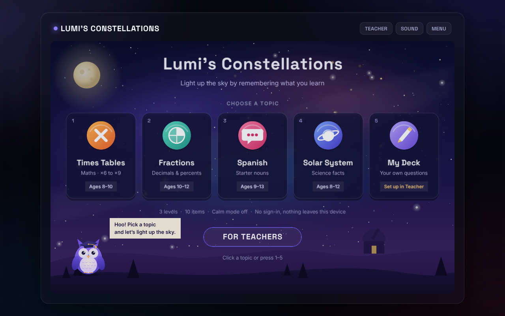
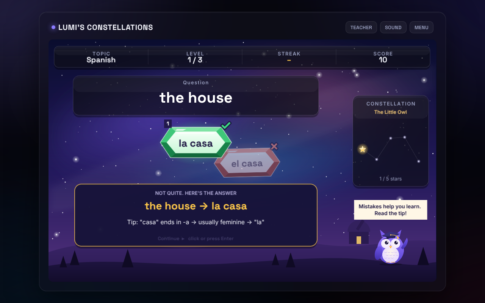
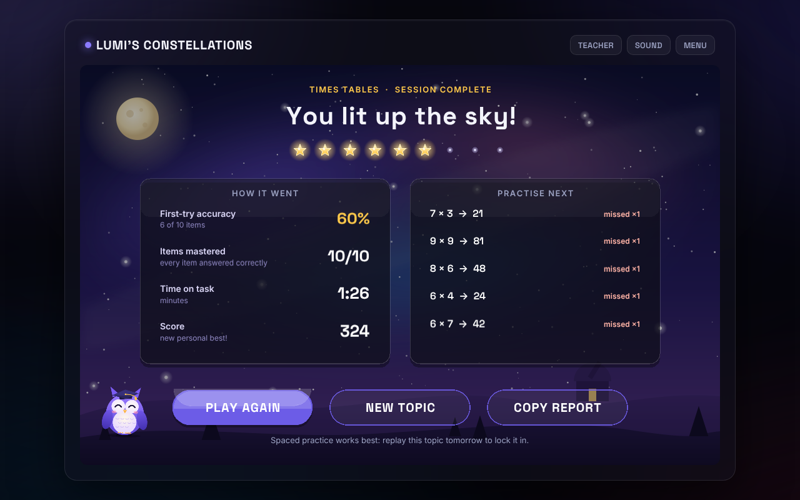

# Lumi's Constellations

A browser game for classroom retrieval practice. Students answer questions to light up constellations, guided by Lumi the owl. The game is built for learning first: it uses retrieval practice, explanatory feedback, spacing, interleaving and mastery-based levels, and it gives the teacher a report at the end.



## Play it

```bash
python3 -m http.server 8000
```

Then open <http://localhost:8000>. It works on any static host (Netlify, Vercel, GitHub Pages, itch.io) with no build step. Phaser is bundled in `vendor/`, so school firewalls that block CDNs don't matter.

**Controls:** click or tap a crystal, or press **1–4**. Press **Enter** to continue. Works with a mouse, a touchscreen or an interactive whiteboard.

## What a session looks like (about 1–3 minutes)

| Level | Name | Choices | Time pressure | What it does |
|---|---|---|---|---|
| 1 | Discover | 2 | none | Introduces the first half of the items, one small chunk at a time |
| 2 | Practise | 3 | crystals drift down slowly | Adds the second half, mixed with a review of earlier items (the ones missed most come first) |
| 3 | Master | 4 | faster drift | Every item, interleaved |

A level ends only when every item in it has been answered correctly. A missed item comes back two questions later.



## Built-in topics

- **Times Tables ×6–×9.** Each miss shows a mental strategy (×9 trick, doubling, splitting). Wrong options are neighbouring facts, the usual slips.
- **Fractions, decimals and percents.** Wrong options are typical misconceptions, e.g. 1/4 → 0.4.
- **Spanish starter nouns.** Covers articles, exceptions (el día, la mano, el agua) and false friends (librería).
- **Solar System.** Targets misconceptions such as seasons being caused by distance, or Mercury being the hottest planet.
- **My Deck.** Teachers type their own `question = answer | why` lines in the **Teacher** panel. This works for any subject.

## For teachers: why it works

| Principle | How the game uses it |
|---|---|
| Retrieval practice | Students recall answers instead of re-reading them |
| Explanatory feedback | Every miss shows the correct answer plus a short reason or strategy |
| Spacing | Missed items return after 2 questions, and again in Level 3 |
| Interleaving | Level 3 mixes all items, so students have to pick the right fact or strategy |
| Scaffolding / cognitive load | Items arrive in chunks. Choices go 2 → 3 → 4, and the timer only starts in Level 2 |
| Low stakes, mastery | No lives and no game over. Progress is never taken away. Lumi praises effort and correcting mistakes |
| Formative assessment | The results screen shows first-try accuracy and which items to practise next. **Copy report** gives you a text summary |



**Settings** (Teacher panel): **Calm mode** turns off the timer completely (useful for SEN support, anxious learners or brand-new content). **Items per session** can be 6, 8, 10 or 12.

**Privacy:** there are no accounts, analytics or network calls with student data. The custom deck and settings are stored in the browser's `localStorage` on that device only.

**Accessibility:** large high-contrast text, keyboard play, and gentle sounds and visuals for mistakes (no red flashes). Correct and wrong are shown with ✓ / ✗ marks as well as colour. There's a mute button in the header.

## Project layout

```
index.html            page shell + Teacher panel
game-ui.css, teacher.css
src/content.js        topic packs + custom-deck parser   ← add topics here
src/learning.js       learning engine (chunking, spacing, interleaving, mastery, report)
src/scenes/           Boot → Preload → Menu → Game → Results
src/gameui.js         in-canvas UI kit · src/juice.js effects · src/audio.js synth sound
assets/               art (generated by tools/make-art.mjs from hand-authored SVG)
vendor/phaser.min.js  Phaser 3.80.1
```

### Adding a topic

Add an entry to `TOPICS` in `src/content.js`, with items shaped like `{ q, a, why, d: [distractors] }`. Hand-picked distractors (`d`) should be real misconceptions. If you leave them out, other answers from the same topic are used.

### Regenerating the art

```bash
SHARP_FROM=/path/with/node_modules/sharp node tools/make-art.mjs
```
