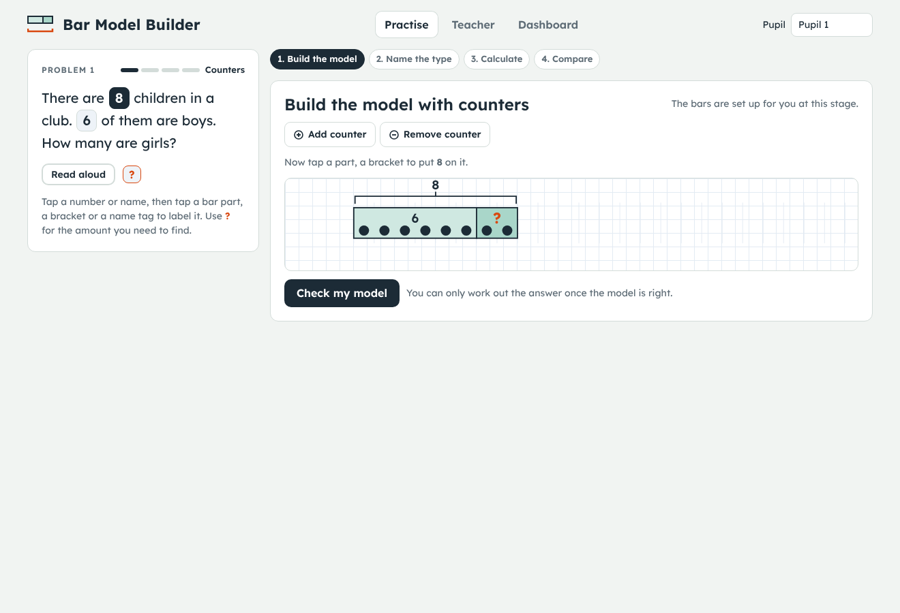
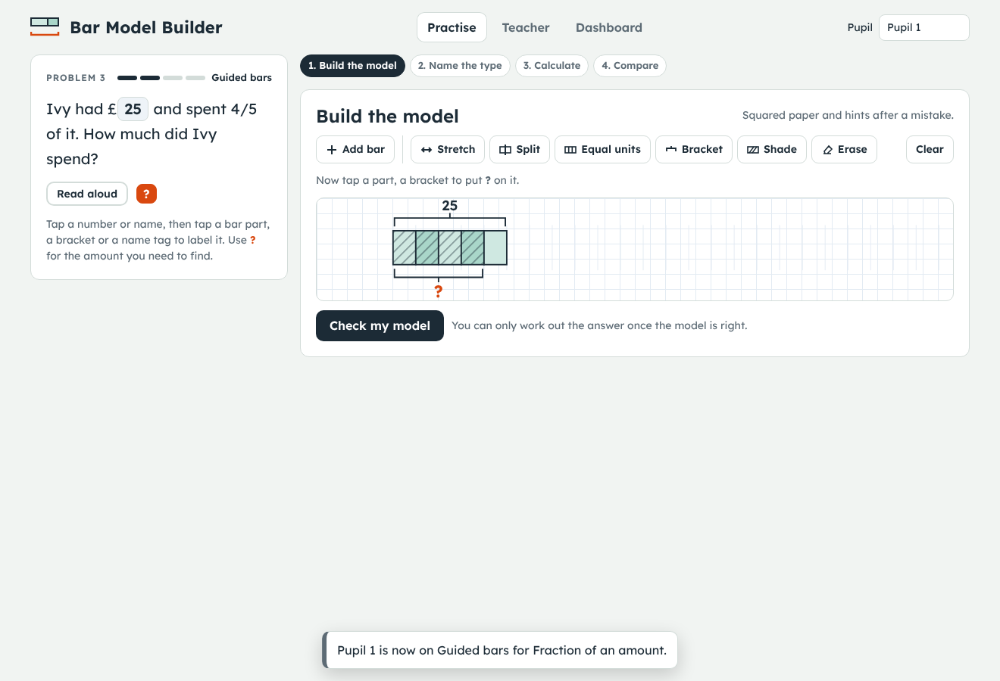
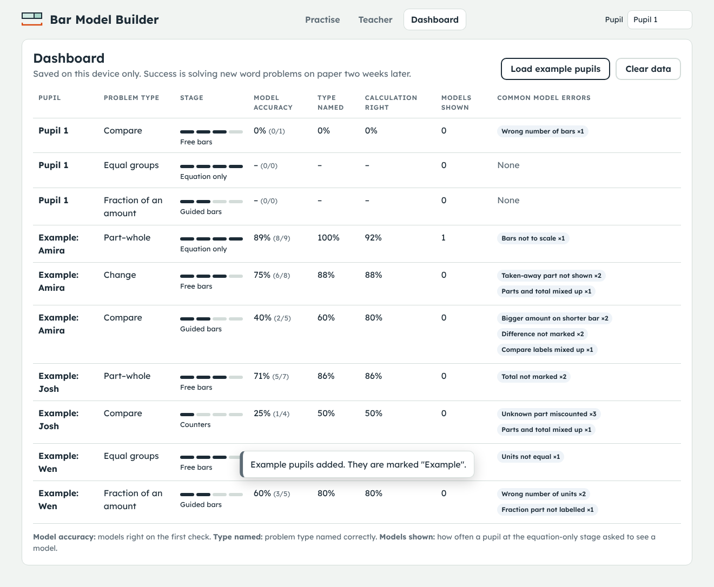

# Bar Model Builder

A demo of the **Bar Model Builder** spec: a word-problem game where the pupil's main move is building a bar model (tape diagram) of the problem's structure. The answer can only be entered after the model is accepted.

Two files (`index.html` and `app.js`), no build step, no dependencies. From the repo root:

```bash
python3 -m http.server 8000
```

Then open <http://localhost:8000/bar-model-builder/>. You can also open `index.html` directly in a browser.

## What the demo covers

| Spec area | In the demo |
|---|---|
| Problem schemas | Levels 1–5: part–whole, change (join and separate), compare, equal groups / times as many, fraction of an amount. Each problem type comes in several contexts (money, length, people, objects) |
| Problem card | Story with tappable quantities and names, a **?** chip for the unknown, and read-aloud |
| Builder | Add bar, stretch (drag handles, snaps to units), split, equal units, bracket (can reach past a bar's end to show a difference), shade, erase, and labels placed by tapping a chip then a part, bracket or name tag |
| Turn loop | Build → check the model → name the problem type → write the calculation (typed numbers light up on the model) → answer → compare with an expert model |
| Model check | Checks structure, not pixels: number of bars, parts and units, whole and difference brackets, names, where the **?** is, shading, equal units, and the relative order of lengths. It accepts valid alternatives, e.g. a whole bar drawn above a split bar, or a compare model with the longer bar split into "same + difference" |
| Feedback | Points at the structure ("Who has more? That bar should be longer.") and never suggests keywords |
| Fading per schema | **Counters** (template given, counters fill the bars) → **Guided bars** (squared paper, hints after a mistake) → **Free bars** (no grid, no hints) → **Equation only** (model on request, logged). Up a stage after 3 correct models in a row, back after 2 wrong first tries in a row |
| Mixed review | Once two or more types reach Free bars, problems are mixed, so the pupil has to choose the model |
| Teacher | Choose problem types and number range, set a pupil's stage, and write custom problems through a structure-definition form with a live expert-model preview |
| Dashboard | Per pupil and type: stage, first-check model accuracy, type-naming accuracy, calculation accuracy, models shown at Equation only, and the most common model errors |
| Printable | Six problem cards with blank squared templates |







## Not in the demo yet

- Level 6 (ratio, proportion, percent, two-step)
- Whole-class mode, where the teacher displays 2–3 pupils' models side by side
- Freehand drawing at the Free stage (snap bars are kept, one of the spec's open questions)
- Moving bars horizontally: every bar starts at the left edge, so alignment is automatic
- Keyboard-only building
- A shared dashboard across devices: data lives in the browser's `localStorage`
- The delayed paper post-test and the answer-only control group for the pilot

The spec notes that there is no trial of a bar model game, only of the mechanism (schema-based instruction and concreteness fading), so the game itself still needs validating.
