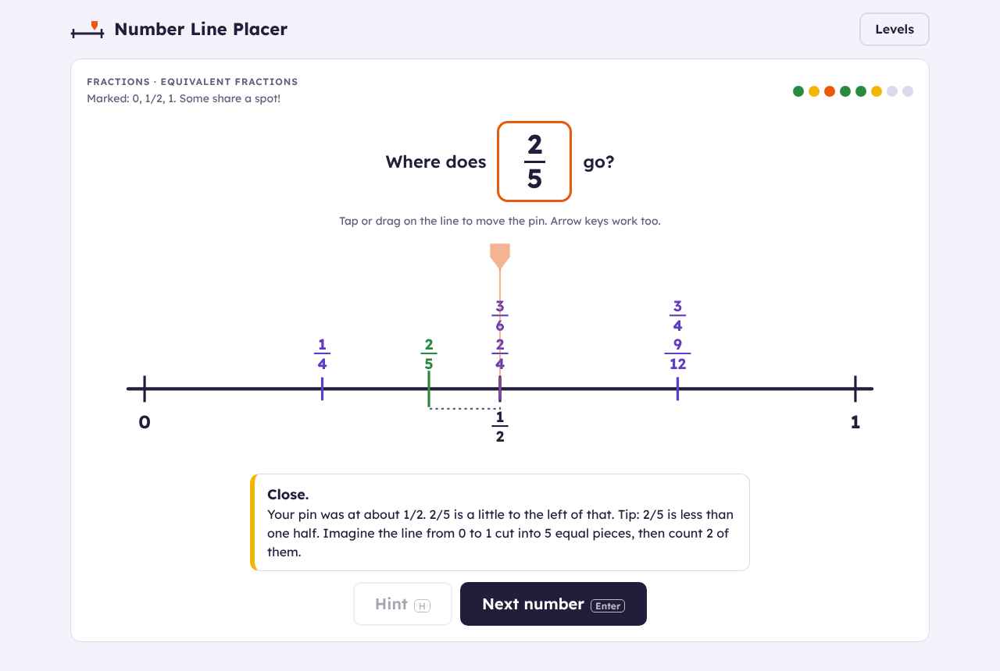
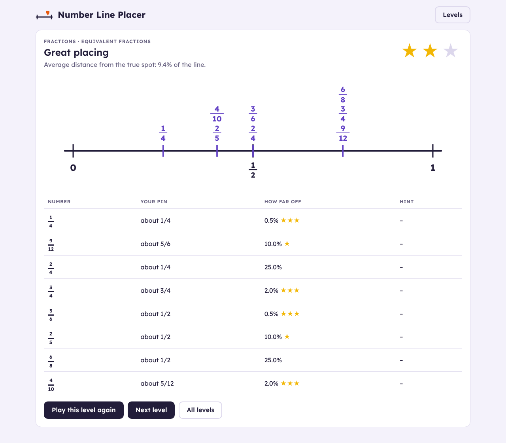

# Number Line Placer

A number line shows a few marked points. A number appears on a card, and the pupil drags a pin to where they think it goes. The game then shows the true position and how far off the pin was. Every number placed stays on the line, so the line fills up with reference points as the round goes on.

One file (`index.html`), no build step. From the repo root:

```bash
python3 -m http.server 8000
```

Then open <http://localhost:8000/number-line-placer/>, or open `index.html` directly.

## Levels

| Whole numbers | Fractions |
|---|---|
| 0 to 10 (marked 0, 5, 10) | Halves, quarters, eighths (marked 0, 1/2, 1) |
| 0 to 20 (marked 0, 10, 20) | Thirds, fifths, tenths (marked 0, 1) |
| 0 to 100 (marked 0, 50, 100) | Equivalent fractions: 2/4, 3/6 and 4/8 all land on 1/2 |
| 0 to 100, ends only | Beyond 1: 3/2, 1 1/4, 7/4… on a 0–2 line |
| 0 to 1,000 (marked 0, 500, 1,000) | |

## How it plays

- **Place:** tap or drag on the line, or use the arrow keys (hold Shift for fine steps), then press *Place it* or Enter. The pin never shows a number, so pupils have to estimate.
- **Feedback:** the true position appears in green with a dotted bracket to the pin. The message says which way to move ("a little to the right") and, after a big miss, gives a strategy: "between 0 and 50, closer to 0", "less than one half: cut 0 to 1 into 5 equal pieces and count 2", or "find 1 first, then add the extra 1/4". Equivalent fractions are pointed out when they land on a point that is already marked.
- **Hint (optional):** for whole numbers, a dashed mark halfway between the nearest known points. For fractions, the line split into the card's denominator.
- **Score:** distance from the true spot as a percentage of the line. Each number gets 0–3 stars, and the round gets stars from the average distance. The best result is kept for each level. There is no timer.
- **Teacher settings:** numbers per round (6, 8 or 10), keep placed numbers on the line, allow hints.





## Not in the demo yet

- Lines with an unmarked end ("this is 0, this is 1, where is 2?")
- Decimals and negative numbers
- A per-pupil teacher dashboard: best scores are saved in the browser's `localStorage`
