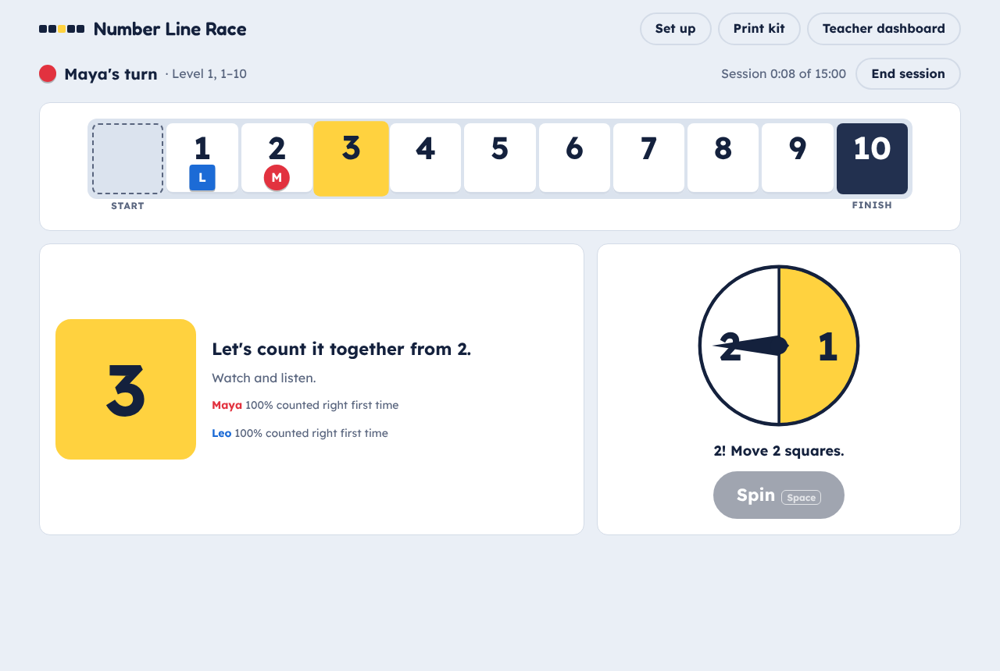
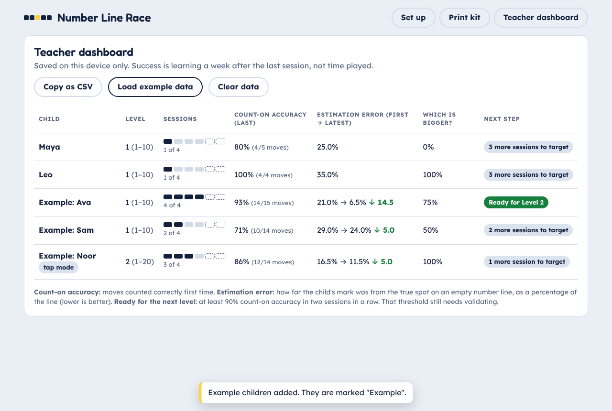

# Number Line Race

A demo of the **Linear Number Board Game** spec: a race game whose board is a number line. Children move one square at a time and say each number they land on ("6, 7", never "1, 2"). That counting-on step is what builds a linear mental number line.

It is a single file (`index.html`) with no build step and no dependencies. Open it in a browser, or serve the folder:

```bash
python3 -m http.server 8000
```

Then go to <http://localhost:8000/number-line-race/> from the repo root.

## What the demo covers

| Spec area | In the demo |
|---|---|
| Board | 1–10, 1–20, 1–100 (10 × 10, rows or snake), 0–1 in tenths. Equal squares, a numeral on every square, tens landmarks. Counters sit below the numeral so it is never covered |
| Turn loop | Spin (1–2 or 1–6) → move one square per number said → on a mistake the counter goes back, the squares light up one by one (with optional voice), then the child replays the move |
| Modes | **Say it aloud**: a partner or the teacher presses *Said it right* / *Not quite* (keyboard: Space to spin, Enter, X) for whiteboard and pair play. **Tap each square**: solo play, tap the squares in order |
| Session | Session clock against a 15 or 20 minute target. No timer on counting |
| Quick check | After each session, per child: two estimates on an empty number line plus one "which is bigger?". No feedback shown |
| Teacher dashboard | Per child: sessions played against the 4–6 session dose, count-on accuracy (moves counted right first time), estimation error first → latest, "which is bigger?" accuracy, and "Ready for Level N" after two sessions at ≥ 90%. Copy as CSV. Example data available |
| Printable | A print kit with the board (1–20 as two strips to tape into one line), 1–2 and 1–6 spinners, a teacher script and a record sheet |
| Guardrails | No rewards, avatars, shops, power-ups, auto-move or counting timers. Level 4 and tap mode are labelled as not yet validated |

## Not in the demo yet

- The 0–1,000 board (Level 4)
- Optional snakes and ladders on Level 3
- Voice recognition (the spec lists its reliability as an open question)
- A shared, cross-device dashboard: data is stored in the browser's `localStorage` on one device
- The pilot A/B colour-board control condition





Evidence: Siegler & Ramani 2008; Laski & Siegler 2014; WWC review of Siegler & Ramani 2009. See the spec for links.
